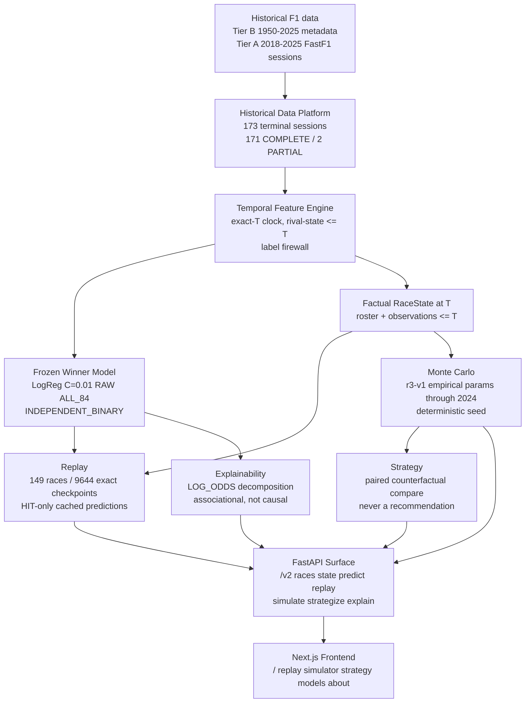
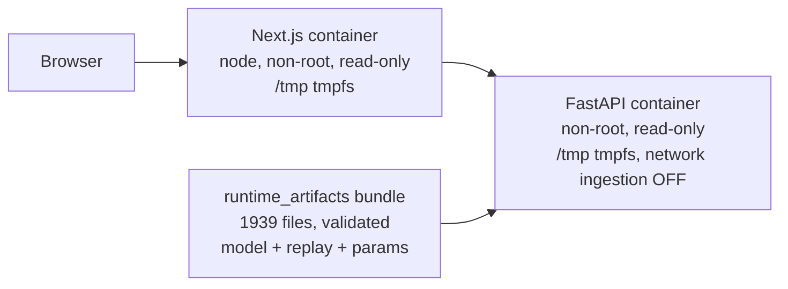

# System Architecture (D-ARCH)

Canonical high-level architecture of frozen F1 Intelligence v2.
Deployment is shown separately from the scientific flow.

Facts shown: data → feature → model/RaceState → replay/MC/explainability →
strategy → API → frontend; exactly two Compose services (LOCAL
DEPLOYABLE RUNTIME). Sources: P11-2 summary (scientific_identities,
runtime, containers), `about.v1.json` system semantics, P10-5 freeze
report. Not shown (not in v2): DB, Redis, Kafka, Celery, WebSockets,
MLflow, Kubernetes, cloud infrastructure.
