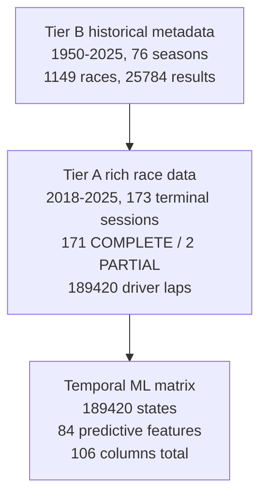

# Dataset (D-DATA)

Tier-B metadata is NOT rich model input. Only Tier-A states feed the
temporal matrix.

Tier-B priors inform pre-race context only. Terminal-session detail:
3458 results, 6336 pit stops, 9324 stints, 25779 weather rows, 14992
race-control rows. Sources: `about.v1.json` dataset_statistics,
`docs/generated/phase2_freeze_manifest.json`, `DATASET_V2_REPORT.md`,
`PHASE2_FINAL_REPORT.md`.
