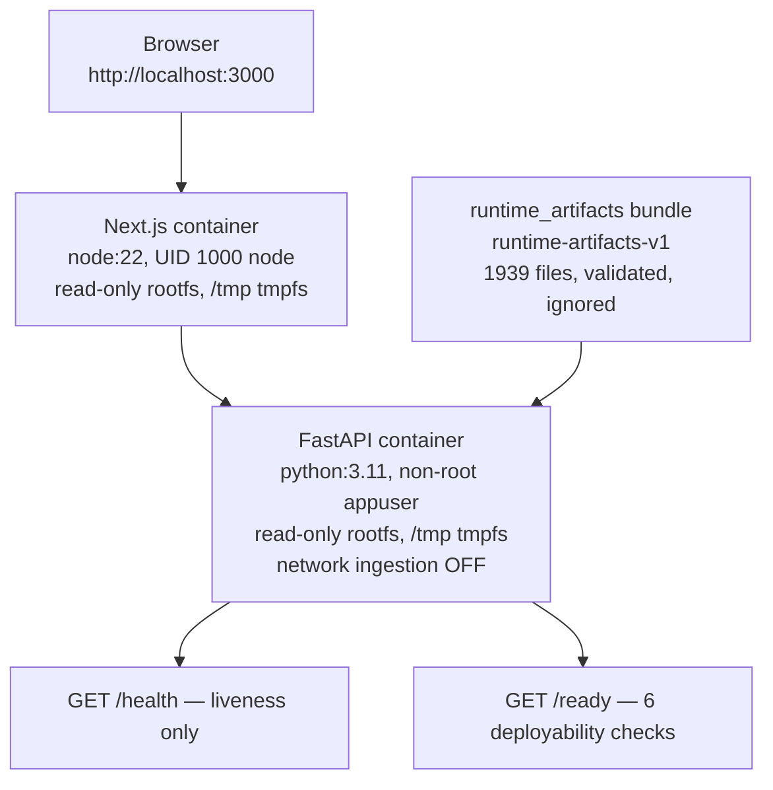

# Deployment — Local Deployable Runtime (D-DEPLOY)

No cloud infrastructure exists. No production cloud deployment is implied.

Exactly two Compose services (backend + frontend). No volumes/bind
mounts, no secrets, no DB/Redis/worker/proxy. CORS: explicit
`http://localhost:3000` only, no wildcard. Observability: one
`request_complete` record per request (method, templated path, status,
endpoint duration only). Sources: P11-2 summary (containers, runtime,
health_readiness, observability, cors), P10-5 freeze report.
