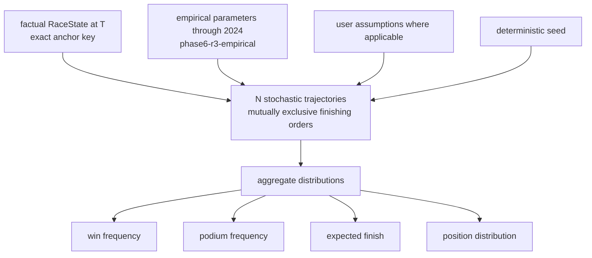

# Monte Carlo Workflow (D-MC)

Deferred v2 dynamics (exact P11-2 limitation wording): weather deferred;
SC/VSC deferred; reliability deferred; constructor-shared pace; free-air
only; no DNF; no traffic; over-pitting ≈0.3–0.4; compound change is
identity only with no pace delta. Measured: 10,000-trial simulation
p50 ≈15.4 s native / ≈16.5 s container (P11-3 B6b). Sources: P11-2
summary (simulation), `PHASE6_VALIDATION_REPORT.md`,
`PHASE6_FINAL_REPORT.md` (42 states / 23 races; LL 1.2237, Brier
0.02669, Top-1 0.643, Top-3 0.881, MAE 2.4452, RPS 0.0928, ECE 0.01899).
