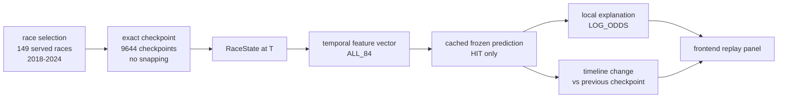

# Historical Replay Workflow (D-REPLAY)

Facts shown: 149 races, 9644 checkpoints, HIT-only exact checkpoints,
cached prediction p50 ≈1.0 ms container. Null semantics: 3206 null
checkpoints are served as null (`NO_OBSERVATION_AT_SNAPSHOT`), never
substituted — not every lap/driver has a prediction. 2025 races refuse
with 404 `unknown_race`. Sources: P11-2 summary (replay, firewall2025),
E2 manifest, P11-3 benchmark (B4a/B4b).
