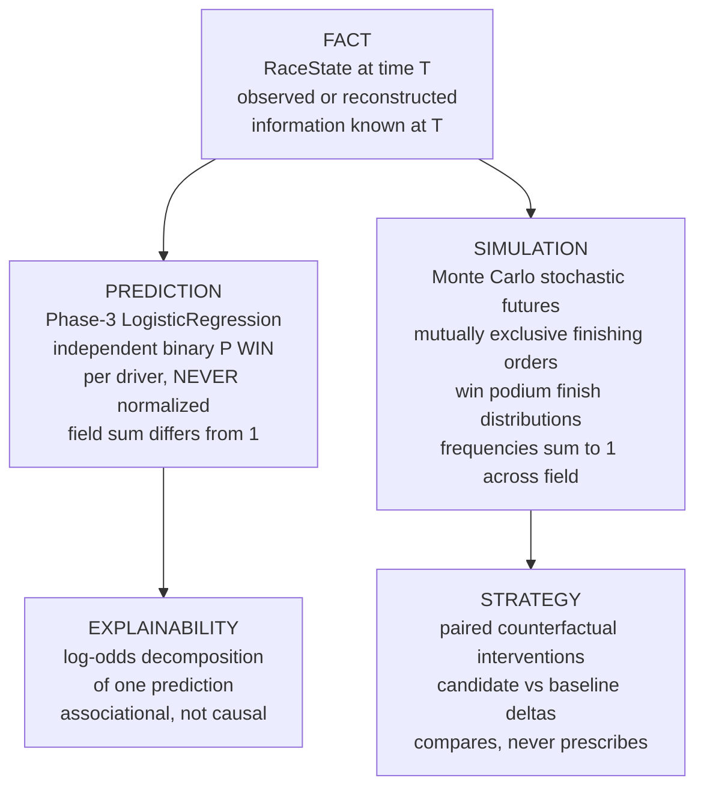

# Fact vs Prediction vs Simulation (D-SEM)

Semantic boundaries. The two probability systems are NOT interchangeable.

Critical distinction: Phase-3 winner probabilities are independent
per-driver binaries (served note: "They do not sum to 1"). Monte Carlo
winner frequencies are mutually exclusive simulated outcomes (measured
field sum 1.0). Different semantics, different purposes; the MC record
does not supersede the winner-model record. Sources: P11-2 summary
(prediction, simulation, strategy, explainability — all EXECUTED).
