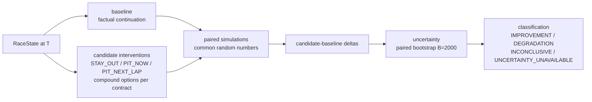

# Strategy Comparison Workflow (D-STRAT)

Compares counterfactual candidates. Never prescribes. No BEST,
RECOMMENDED, or OPTIMAL label appears anywhere in this workflow.

Objectives (required, no default): MAXIMIZE_WIN_PROBABILITY,
MAXIMIZE_PODIUM_PROBABILITY, MINIMIZE_EXPECTED_FINISH. Delta
orientation: win/podium = candidate − baseline (positive improves);
expected finish = baseline − candidate (positive improves, i.e. lowers
finish). CRN adopted with limitations (median variance ratio 0.922
across 711 cells — mixed, never universal). Validation: 99 anchors →
35 eligible, 83 red-team checks, 0 blockers. Measured: comparison
p50 ≈1.0 s native / ≈1.1 s container (P11-3 B7). Sources: P11-2 summary
(strategy), `PHASE7_STRATEGY_FINAL_REPORT.md`, S6 report.
