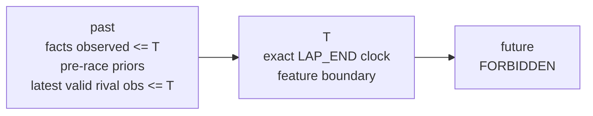
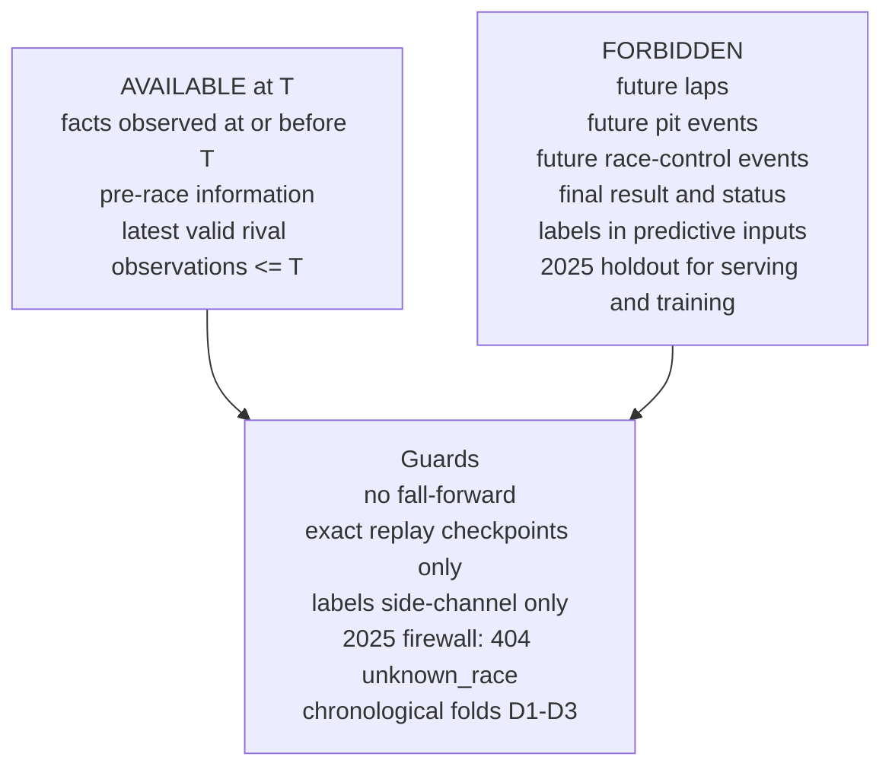

# Temporal Safety (D-TEMP)

The core scientific constraint: at race time T the model may only see
what was observable at or before T.

Facts shown: exact-T boundary, ≤T rival sync, label firewall,
no fall-forward, exact checkpoints, 2025 holdout firewall. Sources:
P11-2 summary (temporal_safety, 10 invariants EXECUTED),
`PHASE2_TEMPORAL_SEMANTICS.md`, `PHASE2_LEAKAGE_PARITY_AUDIT.md`,
D11 adversarial suite. Limitation: evidence wording is "no leakage
detected", never "zero leakage guaranteed".
