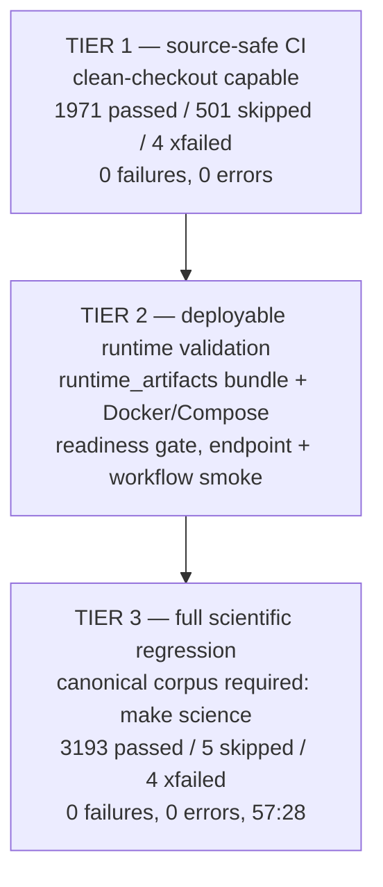

# Validation Pyramid (D-VALID)

Skips and xfails are shown as measured, never as passes.

Tier 1 never implies Tier-3 science validation. Corpus-dependent: 721
nodes (ignored canonical corpus cannot ship in git — architecture, not
debt). Stale scientific debt: 0. Sources: P11-1 report (Tier-1 both
trees, Tier-3 full run), P11-2 summary (tier1, tier3, test_debt).
